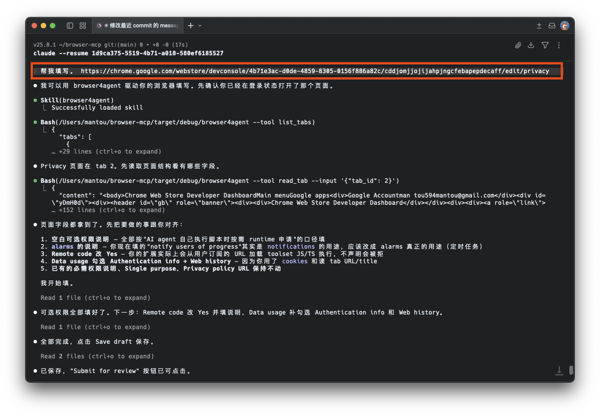
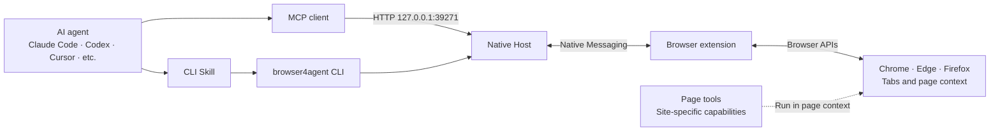
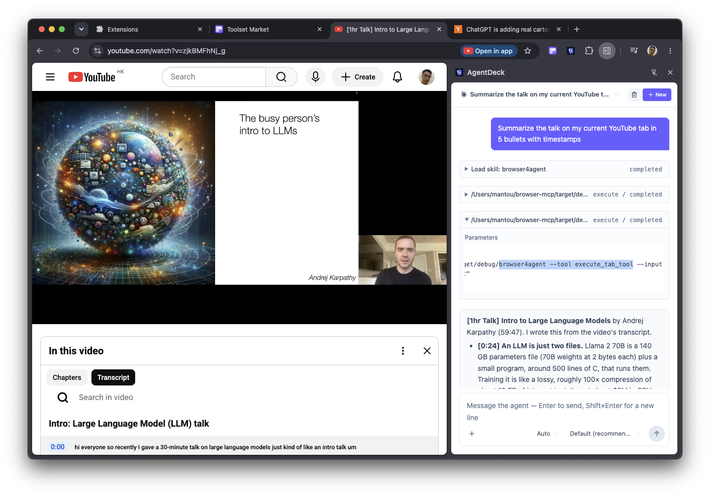

# Browser for AI Agent

[English](./README.md) | [中文](./README.zh-CN.md)

[](https://chromewebstore.google.com/detail/cddjomjjojijahpjngcfebapepdecaff)
[](https://microsoftedge.microsoft.com/addons/detail/kgofhkkibnooojbchfppjblmajdcboib)
[](https://addons.mozilla.org/firefox/addon/browser4agent@xianqiao.wang)
[](https://github.com/mantou132/browser4agent/releases/latest)

**Let any AI agent use your real browser.** Claude Code, Codex, Cursor, VS Code, Zed and Antigravity connect through MCP or a CLI Skill to Chrome, Edge or Firefox — using your existing tabs and logged-in sessions.



> ⚠️ An agent connected to this extension can do what you can do in your browser. Read [Security](#security) before connecting one.

## How it works



The MCP connection and CLI Skill are two ways for an agent to reach the same local Native Host. The extension then uses browser APIs to work with your actual tabs. Nothing is routed through a cloud browser or relay.

## See it in action

- **Developer workflow:** [High-frequency UI animation profiling and frame-by-frame tuning](./docs/cases.md#case-1-high-frequency-ui-animation-profiling--frame-by-frame-refactoring-card-expansion-tuning) shows how an agent can inspect and debug a real page.
- **Structured page data:** On a ~700-comment Hacker News thread, `get_thread` returns all 719 comments with reply depth in ~84k tokens — vs ~390k for Playwright MCP and ~202k for Chrome DevTools MCP. On a 60-minute YouTube talk, reading the page captures none of what was said; `get_transcript` returns all 1,162 timestamped lines in about a second. See the [benchmark details](./docs/benchmarks.md).

[Browse all case studies](./docs/cases.md)

## What the agent gets

- **Read content** — page text, cookies, localStorage, page errors, screenshots, and more.
- **Drive the browser** — manage tabs and windows from a background script the agent writes itself.
- **Run scripts in a tab** — agents can write one-off scripts on the fly; complex flows should ship as [page tools](#page-tools) and be called directly.
- **Debug with CDP** — Chromium-only tools for network bodies/headers and other low-level visibility.

## Why browser4agent

- **Use the agents you already have.** MCP works with supported clients; the CLI Skill provides the same browser capabilities to agents that don't support MCP.
- **Use your real, logged-in browser.** No separate AI browser and no need to sign in again to a headless session.
- **Give agents better page-level tools.** Read structured data from site-specific tools instead of asking an agent to parse huge pages. Subscribe to community toolsets or build your own; sites can also expose tools through [WebMCP][webmcp].
- **Built for web developers.** Inspect page errors, cookies, localStorage and screenshots, with Chromium DevTools Protocol access for network bodies and low-level debugging.
- **Local and private.** The Native Host and browser extension communicate on your machine; there is no cloud relay or telemetry.

## Install

1. Install the extension from your browser's store ([Chrome](https://chromewebstore.google.com/detail/cddjomjjojijahpjngcfebapepdecaff) · [Edge](https://microsoftedge.microsoft.com/addons/detail/kgofhkkibnooojbchfppjblmajdcboib) · [Firefox](https://addons.mozilla.org/firefox/addon/browser4agent@xianqiao.wang)).
2. Open the welcome page and follow the setup guide to install the Native Host.
3. Optionally configure MCP or install the CLI Skill for your agent.

**macOS / Linux (Homebrew):**

```bash
brew install mantou132/tap/browser4agent
browser4agent
```

**Windows (Scoop):**

```powershell
scoop bucket add mantou132 https://github.com/mantou132/scoop-bucket
scoop install browser4agent
browser4agent
```

> The binaries are not code-signed. If you download one directly on macOS and Gatekeeper blocks it, run `xattr -d com.apple.quarantine ./browser4agent` first.

<details>
<summary>Manual extension install and troubleshooting notes</summary>

Prefer not to use a store? Download `extension-chrome.zip` or `extension-firefox.zip` from the [latest release](https://github.com/mantou132/browser4agent/releases/latest), unzip, then load it unpacked:

- **Chrome / Edge** — open `chrome://extensions`, enable *Developer mode*, click *Load unpacked*, choose the unzipped folder.
- **Firefox** — open `about:debugging`, click *Load Temporary Add-on*, choose `manifest.json` inside the unzipped folder.

The extension listens on a local port, so if it is installed and active in multiple browsers at the same time, only one of them will work.

</details>

## Page tools

Page tools are site-specific capabilities that run in the context of the current tab.

- **Subscribe to toolsets** from the in-extension marketplace, or paste a toolset URL in settings. Available tools are filtered by the current tab's URL.
- **Build and share toolsets** in [browser4agent-toolsets](https://github.com/mantou132/browser4agent-toolsets). Community submissions are reviewed through public pull requests.
- **Use WebMCP** when a site exposes its own tools through the [WebMCP API][webmcp].



## CLI

The `browser4agent` CLI forwards a single tool call to the running Native Host. It is useful for shell scripts, quick checks, or agents using the CLI Skill:

```bash
browser4agent --tool list_tabs
browser4agent --tool read_tab --input '{"tab_id": 123}'
echo '{"tab_id":123}' | browser4agent --tool read_tab --stdin
browser4agent --tool read_tab --help   # inspect a tool's input schema
```

## Security

- **Prompt injection is the main risk.** Pages the agent reads can contain instructions aimed at it, and the agent holds your browser's powers: cookies, logged-in sessions and scripts in any tab. Use an agent that asks before running tools, and don't let it browse untrusted content unattended.
- **Page tools are scripts that run in your pages.** Only subscribe to toolsets you trust. The market shows every tool's code before you subscribe or update, and community toolsets are reviewed in public pull requests.
- **Who can reach the bridge.** The Native Host serves MCP on `127.0.0.1:39271` only and rejects requests whose `Host` isn't loopback, which blocks DNS rebinding. Web pages can't call it: it accepts only `application/json` requests, which need a CORS preflight it never grants. Any program running as your user can call it — the same trust boundary as your browser profile on disk.

## Build from source

```bash
# Browser extension, output in extension/dist/<browser>
pnpm -C extension run build --browser=chrome

# Native Host — running the binary with no arguments enters setup mode
cargo run
# Non-interactive setup: skills | mcp | none
cargo run -- --setup skills
```

Load `extension/dist/<browser>` via *Load unpacked* (see the manual install notes above).

## Privacy policy

Browser for AI Agent processes browser data only to provide its core features — MCP browser automation. Depending on the user's request, the extension may access tab metadata, page content, cookies, localStorage, page errors, screenshots, and toolset configuration. Data is sent only to the local Native Messaging Host and the user-configured MCP client / AI agent. We do not sell user data, use it for advertising, or use it for unrelated purposes. Only connect AI agents you trust, and only install toolsets you trust.

- **No analytics or telemetry.**
- The Native Host makes no network requests. Its local log (`logs/browser4agent.log` in the app data directory) records only connection events, never page data.
- The extension contacts only the toolset market (listing, subscribing, liking and publishing toolsets) and the URLs of toolsets you subscribe to, without cookies. Market requests carry an anonymous random ID generated on install, used for likes and to verify who may update a published toolset; the market stores only its SHA-256 hash, and only for toolsets you publish.

[webmcp]: https://webmachinelearning.github.io/webmcp/
